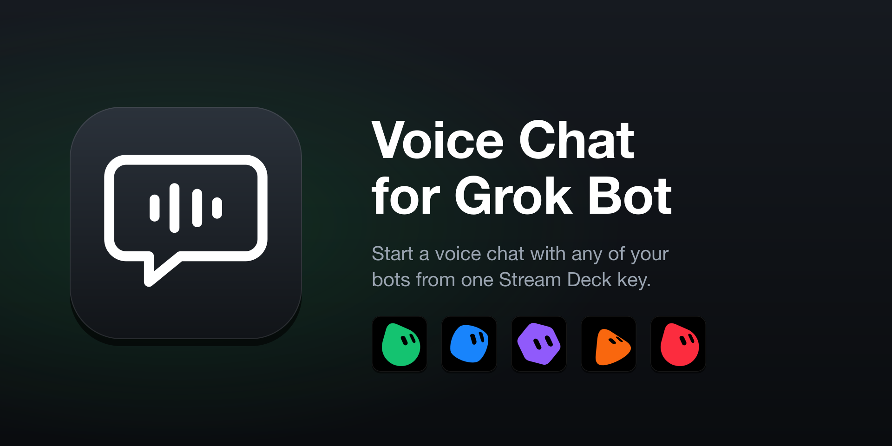
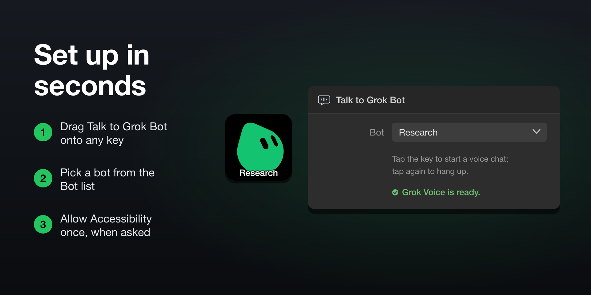
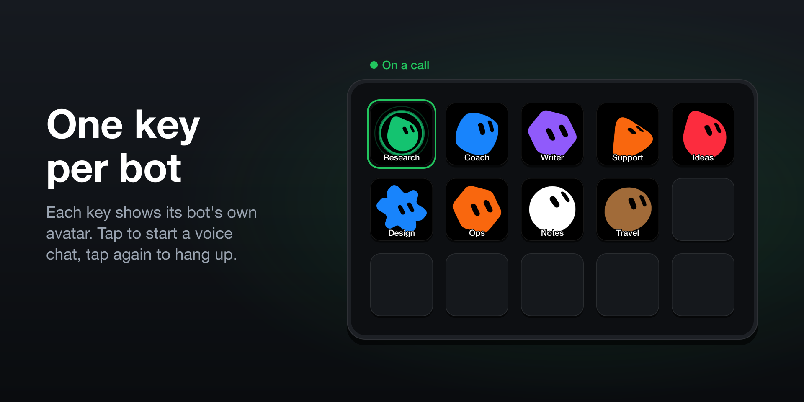
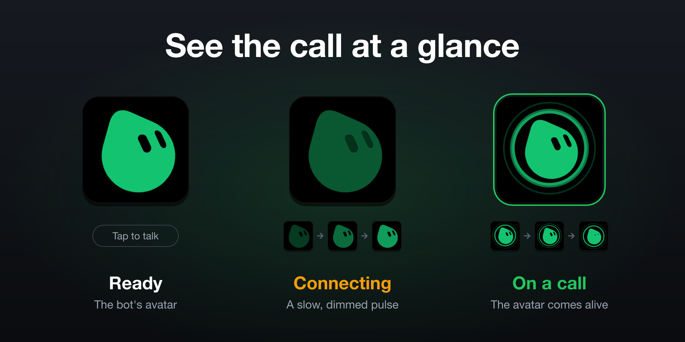

# Voice Chat for Grok Bot



A Stream Deck plugin for macOS. Tap a key to start a voice chat with a Grok Bot bot, and tap it again to hang up.

## Install

You need macOS 13 or later (Apple silicon or Intel), the [Stream Deck app](https://www.elgato.com/downloads) 7.1 or later, and Grok Bot for macOS 0.75.5 or later, signed in with at least one bot.

1. Download [**com.expeditedprojects.grokbot.streamDeckPlugin**](https://github.com/ExpeditedProjects/grokbot-streamdeck-releases/releases/latest/download/com.expeditedprojects.grokbot.streamDeckPlugin).
2. Double-click it and confirm the install in Stream Deck.
3. In Stream Deck's action list, open **Voice Chat for Grok Bot** and drag **Talk to Grok Bot** onto a key.
4. Pick a bot in the **Bot** dropdown.
5. The first time, click **Allow Accessibility…** in the key's settings, then turn on **Grok Voice** in System Settings > Privacy & Security > Accessibility. You only do this once for all your keys.
6. Tap the key to start a call. Tap it again to hang up.

If macOS asks whether to open Grok Voice the first time, click **Open**. Grok Voice is a small helper included in the plugin that clicks Grok Bot's voice button for you ([details](#how-it-works)).



## Using the keys



Each key is set to one bot, so your most-used bots can each have their own key. When idle, the key shows the bot's avatar. It pulses while a call starts or ends, and the avatar animates during the call. A new key may show a plain chat bubble for a moment while the avatar is drawn.



Only one call can be up at a time. Tapping any key during a call hangs it up.

You can type any title in Stream Deck's Title field or leave it empty. The plugin never changes it.

If you set a custom image on a key, Stream Deck shows it instead of the avatar and you lose the call animation. Use "Reset to default" on the key's icon to get them back.

Calls you start inside Grok Bot don't animate any key.

## Update

Download the latest release and double-click it. Your keys and settings are kept. If Grok Voice is running (its window is open or a call is up), quit it first.

## Troubleshooting

**The key shows a warning triangle.** Grok Bot only shows the voice button while the message box is empty, so clear any draft in that bot's chat. Also check that Grok Voice still has Accessibility.

**"Grok Voice needs Accessibility" won't go away.** In System Settings > Privacy & Security > Accessibility, turn Grok Voice off and on again. If that doesn't work, remove it with the minus button and click **Allow Accessibility…** again.

**The key shows a plain bubble or doesn't animate.** The key probably has a custom image; use "Reset to default" on its icon. Otherwise, look for `Grok icon load failed` in the plugin log.

**Tapping the key opens Grok Voice's window instead of starting a call.** No bot is saved for the key yet (open its settings and pick one), or an older Grok Voice is still running (quit it and tap again).

**The bot list is empty.** Open Grok Bot and check that you're signed in.

**The voice button isn't found after a Grok Bot update.** Grok Voice finds the button by its English label, so it needs Grok Bot in English. If the button was renamed, please [open an issue](https://github.com/ExpeditedProjects/grokbot-streamdeck-releases/issues) with your Grok Bot version.

To see your versions and whether Grok Voice has Accessibility, open Grok Voice's status window:

```bash
open "$HOME/Library/Application Support/com.elgato.StreamDeck/Plugins/com.expeditedprojects.grokbot.sdPlugin/bin/Grok Voice.app"
```

Logs:

- Plugin: `~/Library/Application Support/com.elgato.StreamDeck/Plugins/com.expeditedprojects.grokbot.sdPlugin/logs/`
- Stream Deck: `~/Library/Logs/ElgatoStreamDeck/StreamDeck.log`

## Uninstall

1. In Stream Deck, open Settings > Plugins, select **Voice Chat for Grok Bot** and uninstall it.
2. In System Settings > Privacy & Security > Accessibility, select **Grok Voice** and remove it with the minus button.
3. Delete the files it leaves behind:

   ```bash
   rm -rf "$HOME/Library/Application Support/Grok Voice" \
          "$HOME/Library/Application Support/com.expeditedprojects.grokbot"
   ```

## Feedback

Report bugs and request features in [Issues](https://github.com/ExpeditedProjects/grokbot-streamdeck-releases/issues). Include your macOS, Stream Deck and Grok Bot versions, which Grok Voice's status window shows.

## How it works

Grok Bot can't start a voice chat from outside the app. So when you tap a key, the plugin asks Grok Voice, a helper app inside the plugin, to do it. Grok Voice opens the bot in Grok Bot with a `grokbot://` link, waits for its chat to appear, and clicks "Start voice chat" (or "Hang up"). It writes the call's state to a file that the plugin watches to animate the keys, and quits when the call ends. The plugin has been tested with Grok Bot up to 0.75.8.

### Privacy and security

The plugin and Grok Voice make no network requests. The bot list and avatars come from Grok Bot's data on your Mac.

Accessibility lets an app read and press controls in other apps. Only Grok Voice gets it, and it only uses it to press Grok Bot's voice and hang-up buttons. Keeping it in a separate app means Stream Deck doesn't need Accessibility, which would extend it to every Stream Deck plugin.

Web pages and other apps can't start or end calls, because Grok Voice doesn't register a link type. Grok Voice is built with the hardened runtime, which blocks other code from being injected into it. It's signed with a Developer ID and notarized by Apple, so macOS can check it hasn't been changed.

Grok Voice stores the call state and its Accessibility check in `~/Library/Application Support/Grok Voice/`. Avatar images go in `~/Library/Application Support/com.expeditedprojects.grokbot/icons/`.

This project isn't affiliated with Elgato or with the makers of Grok Bot.

## License

[MIT](LICENSE)
